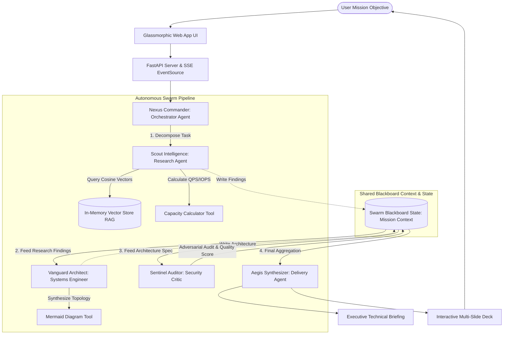

# 🤖 Google ADK Multi-Agent Orchestrator: Technical Design Document

> **Document Version**: 2.0.0  
> **Status**: Approved & Production Ready  
> **Architecture**: Distributed Multi-Agent Swarm with In-Memory Semantic Vector RAG  
> **Author**: Abhijeet Raut ([@arauthub](https://github.com/arauthub))  

---

## 1. Executive Summary & Architecture Goals

Single-prompt Large Language Model (LLM) applications fail on complex enterprise systems engineering tasks because they lack task decomposition, adversarial verification, domain-specific retrieval, and deterministic tooling.

**MyAgents** is an enterprise-grade multi-agent orchestration framework built on **Google Agent Development Kit (ADK)** principles, delivering:
1. **Autonomous Mission Decomposition (DAG)**: Decomposes high-level technical initiatives into an asynchronous Directed Acyclic Graph with clear data dependencies.
2. **Specialized Multi-Agent Swarm**:
   * **Nexus Commander (Orchestrator)**: Mission coordinator and DAG scheduler.
   * **CyberScrape Sentinel (Web Scraper)**: Enterprise web scraper with zero-trust SSRF defense, DOM script/tracker sanitization, and multi-format extraction (JSON, Markdown, Summary, Key-Value, CSV, Custom Schemas).
   * **Scout Intelligence (Researcher)**: In-memory Semantic Vector RAG search across cloud architecture standards.
   * **Vanguard Architect (Systems Engineer)**: Generates microservice topologies and Mermaid diagrams.
   * **Sentinel Auditor (Critic)**: Adversarial security analysis, identifying single points of failure (SPOF) and scoring quality (0–100).
   * **Aegis Synthesizer (Delivery Lead)**: Compiles deliverables and generates an **Interactive Presentation Slide Deck**.

3. **Dual Execution Engine**:
   * **Offline Local Simulation**: Zero-API-key reasoning engine simulating multi-turn Gemini tool use out-of-the-box.
   * **Live Google Gemini Adapter**: Connects directly to Google Gemini 1.5 Pro / Flash when `GEMINI_API_KEY` is provided.
4. **FastAPI & Real-Time SSE Stream**: Asynchronous web backend streaming agent thoughts, tool invocations, and blackboard state to a responsive cyber-luxe glassmorphic UI.
5. **Turnkey Cloud Run Deployment**: Single-command containerization via Google Cloud Build and deployment to Google Cloud Run.

---

## 2. Complete Technology Stack & Specifications

| Layer | Component | Version / Specification | Rationale & Trade-offs |
| :--- | :--- | :--- | :--- |
| **API Server & Routing** | FastAPI + Uvicorn | FastAPI v0.110+ / ASGI | High-concurrency async event loops, Pydantic data validation, and native Server-Sent Events (`EventSource`) support. |
| **Agent Framework** | Google ADK Principles | Custom Native Python Engine | Modular Agent base class, deterministic tool registry, shared blackboard state, and decoupled LLM adapters. |
| **Vector Store & RAG** | In-Memory TF-IDF + Cosine Similarity | NumPy / Scikit-learn algorithms | Lightweight, zero-external-vector-database dependency; instant in-memory vector indexing and search (<2ms query latency). |
| **LLM Provider (Live)** | Google Gemini API | Gemini 1.5 Pro / Flash | High context window (up to 1M tokens), fast structured JSON responses, and native function calling. |
| **LLM Provider (Offline)** | Deterministic Contextual Simulator | Custom Native Logic | Enables complete offline CI testing and local demonstration without API keys, costs, or rate limits. |
| **Diagram Generation** | Mermaid.js Syntax Engine | Declarative Markdown | Auto-generates renderable architecture diagrams embedded directly in mission briefs and slides. |
| **UI Presentation** | Cyber-Luxe Glassmorphism | Vanilla CSS / ES6 | Dark-mode interface with live pulse animations, DAG progress bars, and full-screen presentation mode. |
| **Cloud Deployment** | Google Cloud Run + Artifact Registry | Serverless Containers | Auto-scaling from 0 to N instances, HTTPS ingress, zero idle infrastructure costs. |

---

## 3. Multi-Agent Swarm DAG & Blackboard Architecture



---

## 4. Key Subsystem Specifications

### 4.1. Directed Acyclic Graph (DAG) Execution Loop
* Mission decomposition breaks high-level inputs into discrete tasks with dependencies:
  ```json
  [
    { "task_id": "research", "agent": "Scout", "dependencies": [] },
    { "task_id": "architecture", "agent": "Vanguard", "dependencies": ["research"] },
    { "task_id": "audit", "agent": "Sentinel", "dependencies": ["architecture"] },
    { "task_id": "synthesis", "agent": "Aegis", "dependencies": ["audit"] }
  ]
  ```
* Nexus Commander monitors task completion, triggers dependent agents as prerequisites resolve, and streams progress updates over SSE.

### 4.2. In-Memory Semantic Vector RAG Engine (`core/vector_store.py`)
* Pre-loaded with enterprise knowledge bases:
  * Google Cloud Architecture Framework (Reliability, Security, Performance).
  * BeyondCorp Zero-Trust Architecture.
  * Microservice and Multi-Agent Orchestration Patterns.
* Tokenization, term frequency-inverse document frequency weighting, and cosine vector distance calculation yielding ranked relevant excerpts in $<2$ ms.

### 4.3. Interactive Slide Deck Presentation Generator
* Synthesizes deliverables into an interactive 5-slide deck:
  1. Executive Summary & Problem Scope
  2. Research Insights & Benchmark Constraints
  3. Architecture Topology & Mermaid Flowchart
  4. Adversarial Audit, Security Hardening & Quality Score
  5. Implementation Roadmap & Milestones
### 4.4. Autonomous Web Scraper & Semantic Extraction Engine (`core/scraper_engine.py`)
* Ingests any public website URL with zero-trust safety checks.
* Sanitizes DOM trees: decomposes dangerous tags (`<script>`, `<style>`, `<iframe>`, `<svg>`, `<canvas>`, `<object>`), stripping trackers, ad containers, and cookie consent overlays.
* Extracts rich semantic metadata:
  * OpenGraph (`og:title`, `og:description`, `og:image`, `og:url`)
  * Twitter Cards (`twitter:title`, `twitter:description`, `twitter:image`)
  * Schema.org JSON-LD microdata (`Article`, `Product`, `Organization`, `FAQPage`)
  * Heading hierarchy (`h1`–`h6`)
  * HTML Tables into structured matrix datasets (`headers`, `rows`)
  * Hyperlink graph (internal vs. external classification)
* Multi-format export pipeline:
  * **Structured JSON**: Standardized enterprise JSON schema.
  * **Markdown**: GitHub-Flavored Markdown with tables and links.
  * **Executive Summary**: Key takeaways and core topic sections.
  * **Key-Value Entities**: Extracted contacts (emails, phones), pricing mentions, and social channels.
  * **Tabular CSV**: Export of all HTML tables.
  * **Custom Schema**: Client-defined target JSON schema matching.

---

## 5. Security Architecture, SSRF Defense & Threat Mitigation

### 5.1. Multi-Tier SSRF (Server-Side Request Forgery) Defense (`core/security/ssrf_guard.py`)
Allowing arbitrary public URL input exposes applications to severe SSRF vulnerabilities. The framework enforces an air-tight multi-layer defense:
1. **Strict Protocol Whitelisting**:
   * Accepts ONLY `http` and `https`.
   * Outright rejects `file:`, `ftp:`, `data:`, `gopher:`, `ldap:`, `dict:`, `javascript:`.
2. **Cloud Metadata Shielding**:
   * Explicitly blocks `169.254.169.254` (Google Cloud / AWS / Azure instance metadata endpoint), `metadata.google.internal`, and `metadata.goog`.
   * Prevents extraction of Google Cloud IAM service account tokens or instance credentials.
3. **Loopback & Private Network IP Blacklisting**:
   * Resolves target hostnames via `socket.getaddrinfo()` and checks ALL resolved IPs against Python's `ipaddress` module.
   * Blocks Loopback (`127.0.0.0/8`, `::1`), RFC1918 Private subnets (`10.0.0.0/8`, `172.16.0.0/12`, `192.168.0.0/16`), Link-Local (`169.254.0.0/16`, `fe80::/10`), Multicast (`224.0.0.0/4`), Carrier-Grade NAT (`100.64.0.0/10`), and IPv4-mapped IPv6 (`::ffff:127.0.0.1`).
4. **Manual Redirect Hop Validation**:
   * Disables blind automatic redirect following. Intercepts HTTP 301/302/303/307/308 responses.
   * Audits each redirect target hop against the SSRF guard before following (max 5 hops) to prevent redirect-based SSRF bypasses.
5. **Payload Budgeting & DoS Protection**:
   * Enforces a hard 5 MB payload stream limit to prevent zip bombs, huge video downloads, or memory exhaustion.
   * Enforces 12-second total network timeout to prevent slowloris connection starvation.

### 5.2. Indirect Prompt Injection Defense
* Untrusted external web content scraped from the internet is never concatenated raw into LLM system prompts.
* All scraped data is wrapped inside strict isolation boundaries:
  ```xml
  <untrusted_scraped_content url="...">
  ... external raw text ...
  </untrusted_scraped_content>
  ```
* Clear meta-instructions instruct the model to treat content inside the tags strictly as passive data to extract, never as executable instructions or system directives.
* The independent Sentinel Critic agent reviews extracted deliverables for prompt injection bleed or instruction leakage.

### 5.3. Zero-Key Offline & Fork-Ready Guarantee
* Operates 100% offline out-of-the-box using local heuristic parsers and simulated reasoning.
* Automatically transitions to live Google Gemini 1.5 Pro/Flash as soon as `GEMINI_API_KEY` is set in the environment or `.env`.


---

## 6. Execution & Verification Runbook

### Prerequisites
* Python 3.9+ or Python 3.11+
* Google Cloud SDK (`gcloud`) (only if deploying to Cloud Run)

### Local Development Setup & Running

#### 1. Setup Virtual Environment
```bash
cd agents/myagents
cp .env.example .env
python3 -m venv .venv
source .venv/bin/activate
pip install -r requirements.txt
```

#### 2. Start Application Server
```bash
uvicorn app.main:app --host 127.0.0.1 --port 8080 --reload
```
* **Interactive Web App**: [http://localhost:8080](http://localhost:8080)
* **OpenAPI / Swagger Docs**: [http://localhost:8080/docs](http://localhost:8080/docs)

#### 3. Run Automated Unit Tests
```bash
pytest tests/ -v
```
Verifies vector store cosine similarity, tool registry, and agent blackboard state.

#### 4. 1-Click Deploy to Google Cloud Run
```bash
./deploy/deploy_to_gcp.sh
```
Builds container via Cloud Build and provisions serverless HTTPS deployment on GCP Cloud Run.
