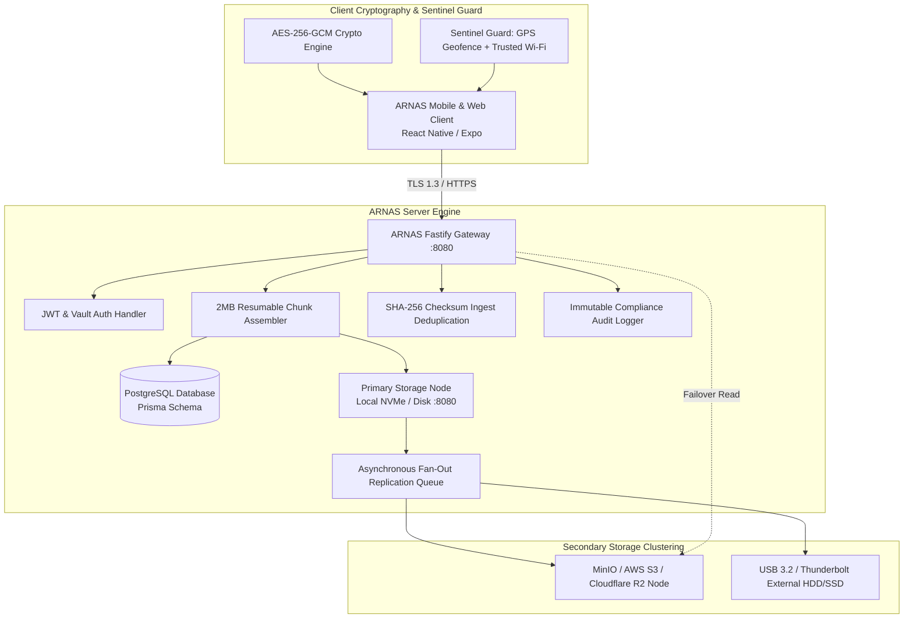

# 🛡️ ARNAS: Technical Design Document

> **Document Version**: 2.0.0  
> **Status**: Approved & Production Ready  
> **Component**: Distributed Private Cloud Storage & Mobile Sentinel Client  
> **Author**: Abhijeet Raut ([@arauthub](https://github.com/arauthub))  

---

## 1. Executive Summary & Architecture Goals

Commercial cloud storage solutions (Google Drive, iCloud, Dropbox) suffer from vendor lock-in, recurring subscription costs, closed-source security models, and involuntary scanning of private media. Traditional DIY NAS solutions (TrueNAS, Synology) lack modern mobile clients with automated zero-knowledge encryption and intelligent battery-safe location sync.

**ARNAS** (Autonomous Raut Network Attached Storage) is an enterprise-grade, self-hosted, distributed private cloud storage system designed to deliver:
1. **Multi-Server Storage Clustering & Instant Ingest**: High-speed local SSD/NVMe writes committed immediately (HTTP 201) with background fan-out replication to secondary object stores (MinIO, AWS S3, Wasabi, Cloudflare R2).
2. **Zero-Knowledge End-to-End Encryption (E2EE)**: Client-side AES-256-GCM encryption before data leaves mobile or web runtimes, secured by PBKDF2 key derivation and 12-word recovery mnemonics.
3. **Location Geofenced & Trusted Wi-Fi Auto-Sync**: Multi-perimeter GPS geofencing (Haversine distance algorithms) and trusted Wi-Fi SSID validation preventing cellular battery drain and data charges.
4. **Comprehensive Enterprise NAS Capabilities**: Folder trees, search, in-place rename, duplicate, 30-day soft-delete recycle bin, expiring passphrase-protected share links, and live S.M.A.R.T. disk telemetry.
5. **Cross-Platform React Native Client**: Unified Expo application running seamlessly across iOS, Android, and Web.
6. **Immutable Audit Compliance Trail**: Cryptographically timestamped logs tracking every access, replication event, and volume state modification.

---

## 2. Complete Technology Stack & Specifications

| Layer | Component | Version / Specification | Architectural Rationale & Trade-offs |
| :--- | :--- | :--- | :--- |
| **Backend API Gateway** | Fastify | v4.26+ (Node.js 20+) | Chosen over Express for extreme low-overhead routing (up to 3x higher throughput), native schema compilation, and asynchronous request lifecycles. |
| **Database ORM** | Prisma ORM | v5.10+ | Type-safe query building, automated migrations, declarative schema modeling, and zero raw SQL injection risks. |
| **Primary Relational DB** | PostgreSQL | v15 / v16 | ACID transactions, robust JSONB support for file metadata, and high-concurrency connection pooling. |
| **Object / Disk Storage** | Local Disk + AWS S3 / MinIO | S3 API Protocol | Hybrid tiered storage: ultra-fast local NVMe ingest combined with S3 API abstraction for asynchronous offsite redundancy. |
| **Cryptography Engine** | AES-256-GCM + PBKDF2 | Web Crypto / Node `crypto` | Authenticated encryption with associated data (AEAD); 100,000 PBKDF2-SHA256 iterations; zero plain-text exposure on server disks. |
| **Mobile Client Framework** | React Native + Expo | Expo SDK 50+ / React Native 0.73+ | Universal cross-platform native codebase targeting iOS, Android, and Web preview with hot-reloading and modular native APIs. |
| **Geofencing & Network** | `expo-location` + `expo-network` | Native Modules | Real-time GPS coordinate sampling and SSID Wi-Fi detection for intelligent background sync triggers. |
| **Image & Media Shaper** | Sharp | v0.33+ | Multi-threaded native image pipeline for WebP thumbnail generation, EXIF stripping, and dimension calculation. |
| **Containerization** | Docker & Docker Compose | Compose Spec 3.8 | Isolated multi-container topology (Fastify, PostgreSQL, MinIO, Redis, Caddy reverse proxy). |
| **Testing Framework** | Vitest + Supertest | Vitest v1.3+ | Blazing fast ESM unit and integration testing validating auth routes, resumable chunk uploads, and replication drivers. |

---

## 3. High-Level Architecture & Cluster Topology



---

## 4. Key Subsystem Specifications

### 4.1. Resumable Chunk Upload & Replication Pipeline
1. **Chunk Ingest**: Client partitions large files into 2 MB chunks (`Content-Range` headers).
2. **Immediate Ingest**: Primary disk writes each chunk to temporary staging; once complete, chunks assemble and compute SHA-256 checksum.
3. **HTTP 201 Response**: Server confirms successful upload within <50ms.
4. **Fan-Out Queue**: File record is queued for secondary nodes. Background worker streams chunks to MinIO/S3 and verifies matching checksums.
5. **Failover Read Mirror**: When a file is requested, if the primary disk throws I/O errors or latency exceeds 1500ms, the orchestrator transparently reads from the secondary S3 replica.

### 4.2. Zero-Knowledge Cryptographic Model
* **Master Vault Key**: Derived via PBKDF2 (SHA-256, 100,000 iterations, 32-byte salt).
* **Payload Encryption**:
  $$\text{Ciphertext} = \text{AES-256-GCM}(\text{Key}, \text{IV}_{12}, \text{Plaintext})$$
* **Storage Invariant**: Plaintext never touches server memory or disk. Server stores only `ciphertext`, `iv`, `tag`, and `encrypted_metadata`.
* **12-Word Mnemonic**: Generates BIP-39 compatible word seed enabling emergency key recovery without server assistance.

### 4.3. GPS Geofencing & Trusted Wi-Fi Sentinel
* **Haversine Distance**:
  $$d = 2r \arcsin\left(\sqrt{\sin^2\left(\frac{\Delta\phi}{2}\right) + \cos(\phi_1)\cos(\phi_2)\sin^2\left(\frac{\Delta\lambda}{2}\right)}\right)$$
* **Validation Logic**:
  * Sync is **ALLOWED** if and only if:
    1. Distance to registered Home/HQ coordinate is $\le \text{perimeterRadius}$ (default: 150 meters).
    2. Active Wi-Fi SSID matches pre-approved list (e.g., `Home-5G`, `Studio-Studio`).
    3. Device battery level $\ge 20\%$ or device is plugged in.
  * Sync is **PAUSED** on 4G/5G cellular, untrusted public Wi-Fi, or when roaming outside geofence.

### 4.4. Enterprise NAS Application Features
* **Hierarchy**: Virtual folders with nested paths and multi-level traversal.
* **Operations**: In-place rename, duplicate, favorite/starring, and move.
* **30-Day Recycle Bin**: Soft delete with `deletedAt` timestamp; files recoverable for 30 days before background worker permanent purge.
* **Expiring Share Links**: Generates cryptographically secure token URLs with configurable TTL (1 hour to 7 days), download limits, and optional passphrases.
* **Telemetry**: Live CPU usage, disk space utilization, read/write throughput (MB/s), and IOPS counters.

---

## 5. Database Schema Architecture (Prisma)

```prisma
model User {
  id             String         @id @default(uuid())
  email          String         @unique
  passwordHash   String
  recoveryHash   String?
  storageUsedBytes BigInt       @default(0)
  storageQuotaBytes BigInt      @default(107374182400) // 100 GB
  files          File[]
  shares         ShareLink[]
  auditLogs      AuditLog[]
  createdAt      DateTime       @default(now())
}

model File {
  id             String         @id @default(uuid())
  userId         String
  user           User           @relation(fields: [userId], references: [id])
  name           String
  path           String
  mimeType       String
  sizeBytes      BigInt
  checksumSha256 String
  isEncrypted    Boolean        @default(false)
  isDeleted      Boolean        @default(false)
  deletedAt      DateTime?
  storageNode    String         @default("primary-nvme")
  replicatedNodes String[]      @default([])
  createdAt      DateTime       @default(now())
  updatedAt      DateTime       @updatedAt
}
```

---

## 6. Execution & Verification Runbook

### Prerequisites
* Node.js v20.x or higher, npm v9+
* Docker & Docker Compose (for PostgreSQL and MinIO)
* Expo CLI (`npm install -g expo-cli` or `npx expo`)

### Step-by-Step Setup & Running

#### 1. Start Infrastructure via Docker
```bash
cd apps/arnas
docker compose up -d postgres minio
```

#### 2. Run Backend Server
```bash
cd apps/arnas/server
cp .env.example .env
npm install
npx prisma generate
npx prisma migrate dev
npm run dev
```
* **API Health**: [http://localhost:8080/health](http://localhost:8080/health)
* **Swagger API Docs**: [http://localhost:8080/docs](http://localhost:8080/docs)

#### 3. Run Mobile Client (Expo)
```bash
cd apps/arnas/mobile
npm install
npm run web
```
* Or for native simulator: `npx expo start --ios` or `npx expo start --android`.

#### 4. Run Automated Tests
```bash
cd apps/arnas/server
npm test
```
Verifies authentication, chunk uploads, E2EE key vaults, and multi-node replication.
