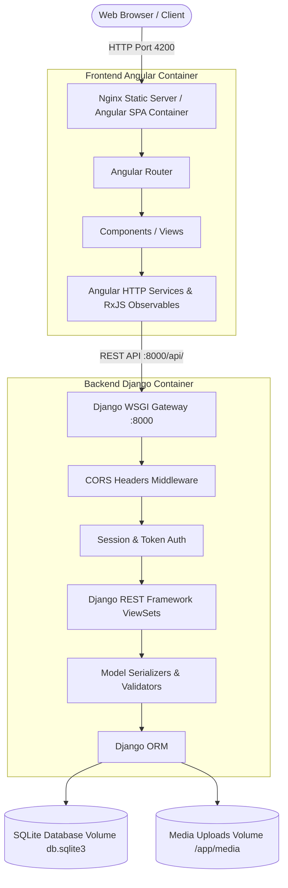

# ⚡ Flashapps: Technical Design Document

> **Document Version**: 1.0.0  
> **Status**: Approved & Production Ready  
> **Architecture**: Decoupled Fullstack Django REST Backend + Angular SPA  
> **Author**: Abhijeet Raut ([@arauthub](https://github.com/arauthub))  

---

## 1. Executive Summary & Architecture Goals

Monolithic web applications frequently suffer from tight coupling between server-rendered templates and client-side interactions, impeding agile frontend iteration and complicating multi-client (mobile, web, third-party) API access.

**Flashapps** is an enterprise-grade decoupled fullstack architecture that pairs:
1. **Django REST Framework (DRF) Backend**: Robust, secure Python service exposing versioned RESTful APIs, data validation, authentication, and content administration.
2. **Angular Reactive Single-Page Application (SPA)**: Modern, component-driven client architecture leveraging TypeScript, RxJS streams, and responsive UI components.
3. **Decoupled Containerization**: Multi-stage Docker builds deploying the backend under Gunicorn/WSGI and frontend under an optimized Nginx Alpine static web server.
4. **Persistent State Management**: Volume-mounted SQLite database allowing rapid zero-dependency local development and container state retention.

---

## 2. Complete Technology Stack & Specifications

| Layer | Component | Version / Specification | Rationale & Trade-offs |
| :--- | :--- | :--- | :--- |
| **Backend Framework** | Django + DRF | Django 4.2+ (LTS) / DRF 3.14+ | Battle-tested security, built-in ORM, automated admin panel, clean serializer contracts, and OpenAPI introspection. |
| **Backend Runtime** | Python | 3.9+ / 3.11+ | High reliability, extensive package ecosystem, mature WSGI runtime support. |
| **Frontend Framework** | Angular | Angular 17+ / 18+ | Enterprise-grade frontend architecture, strict TypeScript typing, dependency injection, and RxJS reactive streams. |
| **Frontend Runtime / Server**| Node.js / Nginx | Node 20 (Build) / Nginx Alpine (Prod) | Multi-stage Docker build producing an ultra-lightweight (<25MB) static runtime image with gzip and caching. |
| **Database** | SQLite3 | 3.x | Zero-configuration file-based relational database suitable for self-contained deployment and volume mounting. |
| **CORS & Middleware** | `django-cors-headers` | v4.3+ | Regulates Cross-Origin Resource Sharing between Angular (`http://localhost:4200`) and Django (`http://localhost:8000`). |
| **Container Engine** | Docker Compose | Specification 3.8 | Orchestrates multi-container networking, shared volumes, and service startup dependencies. |

---

## 3. System Architecture & Topology



---

## 4. Key Subsystem Specifications

### 4.1. Django REST Backend Architecture (`backend/`)
* **Settings Stratification**:
  * `settings/base.py`: Shared apps, middleware, password validators, templates, and REST framework configuration.
  * `settings/dev.py`: Development mode (`DEBUG = True`, local CORS allowances, verbose logging).
  * `settings/production.py`: Hardened settings (`DEBUG = False`, secure cookies, strict `ALLOWED_HOSTS`).
* **API Endpoints**:
  * `/api/v2/pages/`: Wagtail API endpoints exposing structured page trees and streamfields.
  * `/api/`: Custom REST viewsets handling ERP, inventory, catalog, and search queries.
  * `/admin/`: Django Admin dashboard for user and data management.
* **Seeding & Demo Fixtures**:
  * `setup_erp.py`: Seeds enterprise ERP demo records into SQLite.
  * `create_demo_page.py`: Initializes standard demo landing pages.

### 4.2. Angular Frontend Architecture (`frontend/`)
* **State & Data Layer**: Angular Services utilizing `HttpClient` and RxJS `BehaviorSubject` for reactive UI updates without state drift.
* **Component Layout**:
  * Navigation header with responsive drawer.
  * Dashboard view displaying dynamic records fetched from `/api/`.
  * Detail views with reactive forms and validation.
* **Nginx Configuration (`nginx.conf`)**:
  * Serves Angular production build from `/usr/share/nginx/html`.
  * Directs all non-file route queries to `/index.html` to support HTML5 PushState routing.
  * Proxies `/api/` calls upstream to `backend:8000`.

---

## 5. Security & Network Configuration

1. **CORS Governance**:
   * Configured via `CORS_ALLOWED_ORIGINS` in Django settings to permit traffic strictly from verified frontend origins (`http://localhost:4200`, `http://127.0.0.1:4200`).
2. **CSRF Protection**:
   * Safe methods (`GET`, `HEAD`, `OPTIONS`) permitted; state-modifying requests (`POST`, `PUT`, `DELETE`) require standard Django CSRF tokens or token-based authentication.
3. **Data Isolation**:
   * Production builds execute inside unprivileged container users; database and media paths isolated via volume mounts.

---

## 6. Execution & Verification Runbook

### Prerequisites
* Python 3.9+ or Python 3.11+
* Node.js v18+ and npm v9+
* Docker & Docker Compose (optional, for containerized run)

### Running via Docker Compose (Recommended)
```bash
cd devops/docker
docker compose up --build -d
```
* **Frontend SPA**: [http://localhost:4200](http://localhost:4200)
* **Backend API**: [http://localhost:8000](http://localhost:8000)
* **Django Admin**: [http://localhost:8000/admin/](http://localhost:8000/admin/)

### Running Locally Without Docker

#### 1. Setup Backend
```bash
cd apps/flashapps/backend
cp .env.example .env
python3 -m venv venv
source venv/bin/activate
pip install -r requirements.txt
python manage.py migrate
python manage.py runserver 0.0.0.0:8000
```

#### 2. Setup Frontend
```bash
cd apps/flashapps/frontend
npm install
npm start
```
Open [http://localhost:4200](http://localhost:4200) in your browser.
