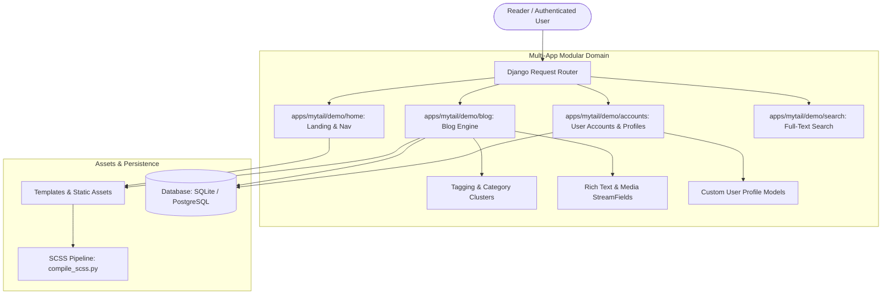

# 📰 Mytail: Technical Design Document

> **Document Version**: 1.0.0  
> **Status**: Approved & Production Ready  
> **Architecture**: Multi-Application Wagtail CMS Blog & Account Platform  
> **Author**: Abhijeet Raut ([@arauthub](https://github.com/arauthub))  

---

## 1. Executive Summary & Architecture Goals

Many CMS architectures cram all business logic, editorial posts, user accounts, and styling into a single monolithic Django app, making code maintenance and separation of concerns difficult as teams expand.

**Mytail** is an enterprise multi-application CMS architecture designed to provide:
1. **Multi-App Domain Separation**: Isolated Django applications for editorial publishing (`blog/`), authentication & profiles (`accounts/`), landing layouts (`home/`), and search discovery (`search/`).
2. **Dynamic SCSS & Tailwind Hybrid Pipeline**: Standalone SCSS asset compilation (`compile_scss.py`) merged with utility Tailwind CSS styling.
3. **Advanced Editorial Taxonomy**: Deep categorization and tagging powered by Wagtail `modelcluster` and `taggit`.
4. **Self-Contained Deployment**: Containerized production environment with volume-mounted media storage and SQLite database persistence.

---

## 2. Complete Technology Stack & Specifications

| Layer | Component | Version / Specification | Rationale & Trade-offs |
| :--- | :--- | :--- | :--- |
| **CMS Engine** | Wagtail CMS | v7.1+ | Enterprise-grade editorial interface, streamfields, draft management, and revision history. |
| **Web Framework** | Django | v5.2+ | Robust authentication framework, ORM, migration system, and security middleware. |
| **Asset Pipeline** | Python SCSS Compiler + Tailwind | Custom `compile_scss.py` | Eliminates external complex Node bundlers for core styles while retaining SCSS nesting and Tailwind utilities. |
| **Taxonomy & Indexing** | `django-taggit` + `modelcluster` | v5.0+ | Enables rich tagging, related post discovery, and parent-child model clustering. |
| **Database** | SQLite / PostgreSQL | Relational DB | Local development defaults to SQLite; production configured for PostgreSQL. |
| **Containerization** | Docker | Dockerfile | Encapsulates Gunicorn WSGI server and static asset compilation. |

---

## 3. System Architecture & Domain Model



---

## 4. Key Subsystem Specifications

### 4.1. Blog Publishing Module (`blog/`)
* **`BlogIndexPage`**: Parent page listing posts with category filters, tag clouds, and pagination.
* **`BlogPostPage`**: Child page holding author attribution, publish date, hero image, tags, and StreamField blocks (rich text, quote, code highlight, embedded video).
* **Tagging**: Integrated via `BlogPageTag` and `modelcluster.contrib.taggit`.

### 4.2. Accounts & Access Control Module (`accounts/`)
* User login, registration, password reset, and profile management views.
* Integrates seamlessly with standard Django authentication backends and Wagtail user permissions.

### 4.3. Asset Compilation Pipeline (`compile_scss.py`)
* Python-native utility monitoring SCSS files in `static/scss/` and outputting compressed CSS to `static/css/`.
* Can be invoked directly during deployment or as part of a file-watching workflow.

---

## 5. Execution & Verification Runbook

### Prerequisites
* Python 3.9+ or Python 3.11+

### Step-by-Step Setup & Running

#### 1. Setup Virtual Environment & Dependencies
```bash
cd apps/mytail/demo
cp .env.example .env
python3 -m venv venv
source venv/bin/activate
pip install -r requirements.txt
```

#### 2. Run Database Migrations
```bash
python manage.py migrate
```

#### 3. Compile SCSS Assets
```bash
python compile_scss.py
```

#### 4. Create Admin Account
```bash
python manage.py createsuperuser
```

#### 5. Start Development Server
```bash
python manage.py runserver 0.0.0.0:8000
```

* **Blog Application**: [http://localhost:8000](http://localhost:8000)
* **Wagtail Admin Panel**: [http://localhost:8000/admin/](http://localhost:8000/admin/)
