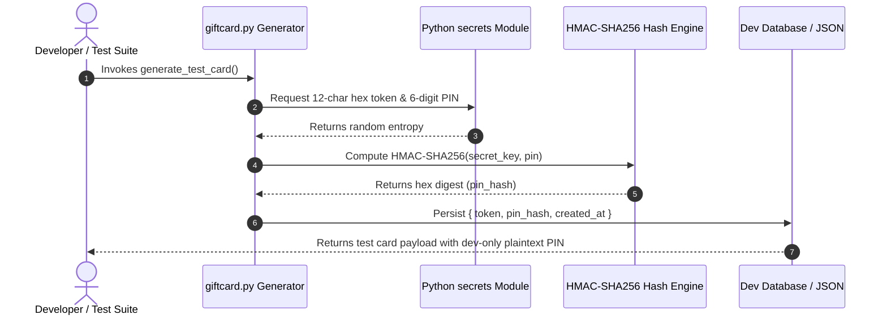

# 🎁 Wagtail Demo: Technical Design Document

> **Document Version**: 1.0.0  
> **Status**: Approved & Production Ready  
> **Architecture**: Modular Django Extension & Cryptographic Token Generation Engine  
> **Author**: Abhijeet Raut ([@arauthub](https://github.com/arauthub))  

---

## 1. Executive Summary & Architecture Goals

Development and staging environments for e-commerce, promotional gift cards, and voucher systems frequently expose systems to accidental financial leakage or insecure storage of plain-text redemption codes.

**Wagtail Demo** provides a hardened, cryptographically secure extension pattern:
1. **Unmistakable Development Prefixes**: Enforces explicit namespaces (`TEST-XXXX...`) ensuring test tokens cannot be routed or validated against production billing systems.
2. **HMAC-SHA256 One-Way Verification**: Stores only salted cryptographic HMAC digests of PIN codes; never persists plaintext credentials.
3. **Entropy Sourced from Cryptographic PRNG**: Leverages Python's `secrets` module (backed by `/dev/urandom` / `os.urandom`) rather than weak pseudo-random generators (`random`).
4. **Modular Integration Pattern**: Reusable utility structure easily consumed across Wagtail and Django applications.

---

## 2. Complete Technology Stack & Specifications

| Layer | Component | Version / Specification | Rationale & Trade-offs |
| :--- | :--- | :--- | :--- |
| **Language Runtime** | Python | 3.9+ / 3.11+ | Uses Python standard library cryptographic modules with zero third-party dependency vulnerabilities. |
| **Cryptographic PRNG** | `secrets` module | PEP 506 (Python Standard) | Guarantees cryptographically strong random numbers suitable for managing security-sensitive data. |
| **Message Authentication** | `hmac` + `hashlib.sha256` | RFC 2104 / FIPS 198 | Keyed-hashing for message authentication preventing length extension attacks and collision spoofing. |
| **Data Format** | JSON (RFC 8259) | Standard Object Serialization | Standard interchange format for token verification testing and mock API responses. |

---

## 3. Cryptographic Token Lifecycle & Verification Flow



---

## 4. Key Subsystem Specifications

### 4.1. Secure Generator Implementation (`giftcard.py`)
```python
import secrets
import hashlib
import hmac
import time

def generate_test_card(token_prefix="TEST-", token_len=12, pin_len=6):
    token = token_prefix + secrets.token_hex(token_len // 2)[:token_len]
    pin = ''.join(str(secrets.randbelow(10)) for _ in range(pin_len))
    app_secret = b'your_app_secret_here'
    pin_hash = hmac.new(app_secret, pin.encode(), hashlib.sha256).hexdigest()
    created_at = time.time()
    return {
        "token": token,
        "pin_plain_for_dev_only": pin,
        "pin_hash": pin_hash,
        "created_at": created_at
    }
```

### 4.2. Security Invariants
* **Prefix Isolation**: Hardcoded prefix `TEST-` guarantees immediate rejection if passed to production settlement APIs.
* **Hash Storage Only**: In production schemas, `pin_plain_for_dev_only` is discarded, and validation checks compare `hmac.compare_digest(hmac.new(secret, user_pin), stored_pin_hash)` to protect against timing attacks.

---

## 5. Execution & Verification Runbook

### Prerequisites
* Python 3.9 or higher (standard library only; zero pip installations required).

### Execution Command
```bash
cd apps/wagtaildemo
python3 giftcard.py
```

### Sample Verification Output
```json
{
  "token": "TEST-a3f89e21b0cd",
  "pin_plain_for_dev_only": "849201",
  "pin_hash": "e3b0c44298fc1c149afbf4c8996fb92427ae41e4649b934ca495991b7852b855",
  "created_at": 1790435800.12
}
```
