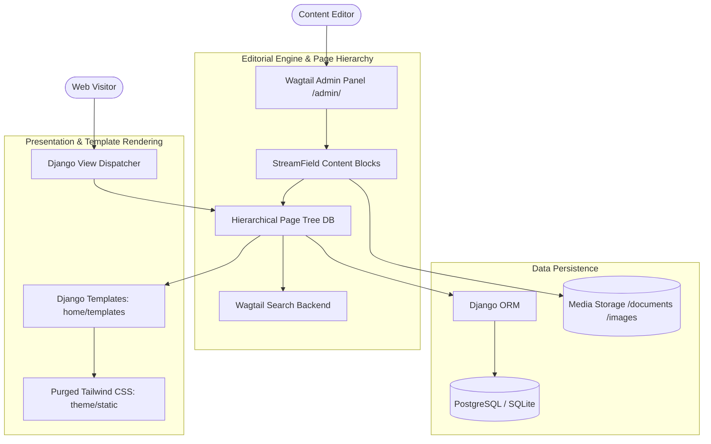

# 🌊 Wagtailwind: Technical Design Document

> **Document Version**: 1.0.0  
> **Status**: Approved & Production Ready  
> **Architecture**: Enterprise Wagtail CMS Integrated with Tailwind CSS Design System  
> **Author**: Abhijeet Raut ([@arauthub](https://github.com/arauthub))  

---

## 1. Executive Summary & Architecture Goals

Traditional enterprise content management systems (CMS) often force editorial teams to choose between cumbersome page builders with bloated HTML output or developer-centric static site generators that require code commits to publish text.

**Wagtailwind** resolves this dichotomy by combining:
1. **Wagtail CMS & Django**: Intuitive, high-security Python content management engine featuring live drafts, scheduled publication, granular role-based permissions, and hierarchical page trees.
2. **Tailwind CSS Utility Design System**: Purged, zero-runtime-overhead utility stylesheet compilation integrated via `django-tailwind`.
3. **Structured Editorial Components (StreamFields)**: Reusable, structured content blocks allowing content authors to assemble beautiful, on-brand landing pages without CSS regressions.
4. **Fast Full-Text Search Backend**: Wagtail search engine indexing content models and ranking results with relevance scoring.

---

## 2. Complete Technology Stack & Specifications

| Layer | Component | Version / Specification | Rationale & Trade-offs |
| :--- | :--- | :--- | :--- |
| **CMS Platform** | Wagtail CMS | v7.1+ | Python's premier open-source enterprise CMS, providing streamfields, image renditions, and editorial workflows. |
| **Web Framework** | Django | v5.2+ | Modern Python async capabilities, rock-solid ORM, CSRF protection, and user permission models. |
| **CSS Architecture** | Tailwind CSS | v3.4+ via `django-tailwind` | Utility-first CSS pipeline purging unused utilities in production to deliver minimal asset payloads (<15KB CSS). |
| **Asset Compiler** | Node.js & PostCSS | Node.js 18+ / 20+ | Builds and purges Tailwind stylesheets automatically during deployment or with live file watcher in development. |
| **Database** | PostgreSQL / SQLite | SQLite (Dev) / Postgres (Prod) | Flexible database backend; zero setup for local development with full migration path to managed PostgreSQL. |
| **WSGI Server** | Gunicorn | v21+ | Pre-fork worker model for high-concurrency production serving. |
| **Containerization** | Docker | Multi-Stage Build | Multi-stage image compiling static assets in Node container and serving via minimal Python Alpine runtime. |

---

## 3. System Architecture & Editorial Flow



---

## 4. Key Subsystem Specifications

### 4.1. Tailwind Theme Pipeline (`theme/`)
* **Source Path**: `theme/static_src/` containing `tailwind.config.js` and `src/styles.css`.
* **Build Scripts**:
  * Development watch mode: `python manage.py tailwind start`
  * Production compilation: `python manage.py tailwind build`
* **Purge Scanning**: Configured to parse `home/templates/**/*.html`, `search/templates/**/*.html`, and Wagtail template tags to eliminate unused class names.

### 4.2. Page Models & Content Taxonomy (`home/models.py`)
* **`HomePage`**:
  * Hero banner block with customizable headlines and CTA buttons.
  * Flexible streamfields supporting feature cards, quote testimonials, and image grids.
* **Search Routing (`search/views.py`)**:
  * Full-text search queries filtering against indexed Wagtail `Page` fields with pagination.

---

## 5. Security & Governance

1. **Authentication & Roles**:
   * Wagtail role-based access control (Administrators, Editors, Moderators).
   * Two-factor authentication (2FA) ready via standard Django auth plugins.
2. **Media Security**:
   * Image renditions dynamically generated via Pillow/Sharp logic with secure cryptographic cache keys.

---

## 6. Execution & Verification Runbook

### Prerequisites
* Python 3.9+ or Python 3.11+
* Node.js 18+ (for Tailwind CSS compilation)

### Step-by-Step Setup & Running

#### 1. Setup Virtual Environment
```bash
cd apps/wagtailwind
cp .env.example .env
python3 -m venv venv
source venv/bin/activate
pip install -r requirements.txt
```

#### 2. Run Database Migrations
```bash
python manage.py migrate
```

#### 3. Create Wagtail Admin Account
```bash
python manage.py createsuperuser
```

#### 4. Compile Tailwind Styles (Optional in Dev)
```bash
python manage.py tailwind build
```

#### 5. Start Development Server
```bash
python manage.py runserver 0.0.0.0:8000
```

* **Public Web Interface**: [http://localhost:8000](http://localhost:8000)
* **Wagtail Admin Panel**: [http://localhost:8000/admin/](http://localhost:8000/admin/)
