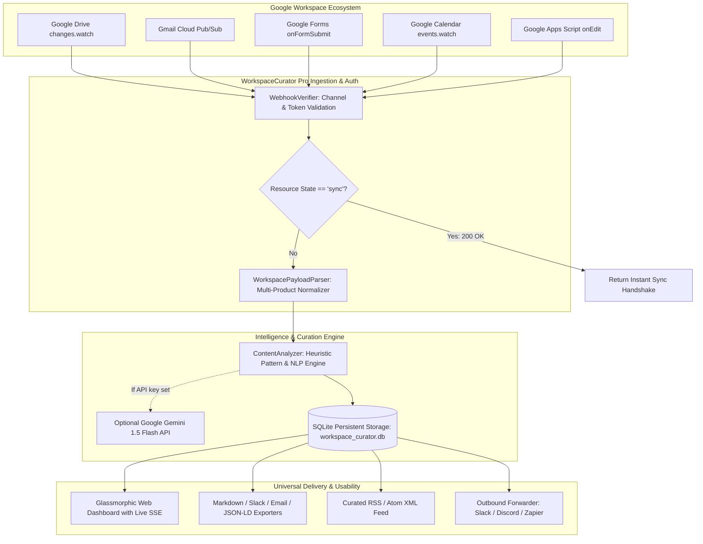

# 🌐 WorkspaceCurator Pro: Technical Design Document

> **Document Version**: 1.0.0  
> **Status**: Approved & Production Ready  
> **Architecture**: Event-Driven Google Workspace Webhook Ingestion, AI Curation & Multi-Format Dispatch Engine  
> **Author**: Abhijeet Raut ([@arauthub](https://github.com/arauthub))  

---

## 1. Executive Summary & Architecture Goals

Modern enterprise workflows generate overwhelming streams of documents, spreadsheet edits, emails, calendar invites, and form submissions across the Google Workspace ecosystem. Traditional notification systems either flood users with raw, context-free alerts or require manual synthesis by knowledge workers.

**WorkspaceCurator Pro** solves this by providing a unified, event-driven webhook ingestion and intelligence platform that:
1. **Listens to All Google Workspace Push Protocols**:
   - Google Drive Push Notifications (`changes.watch` / `files.watch` with handshake sync).
   - Gmail Push Notifications via Google Cloud Pub/Sub envelopes (Base64 decoded).
   - Google Forms submission triggers (`onFormSubmit`).
   - Google Calendar event notifications (`events.watch`).
   - Google Docs & Sheets real-time edit streaming via native Google Apps Script triggers.
   - Universal JSON/REST webhook receiver.
2. **Deep Autonomous Content Curation**:
   - Synthesizes crisp **Executive TL;DR Summaries**.
   - Extracts actionable **Action Item Task Matrices** with assignees (`@Sarah`), deadlines (`by Friday`), and urgency ratings (`Low`, `Medium`, `High`, `Critical`).
   - Extracts quantitative metrics (`$1.45M`, `34% growth`, `sub-25ms latency`).
   - Performs Named Entity Recognition (Platforms, Companies, Dates, Systems).
   - Computes sentiment polarity, urgency scores (0–100), and flags critical Sev-1/P0 escalations.
3. **Universal Consumption & Accessibility ("Anyone Can Use It Easily")**:
   - **Executive Dashboard UI**: Cyber-space glassmorphic dark-mode web application with real-time Server-Sent Events (SSE) updates, live product filter chips, and interactive task checklists.
   - **Multi-Format Export**: 1-click export to Clean Markdown (for Obsidian/Notion/GitHub), Slack Block Digests, Executive Email Briefings, and JSON-LD schema.
   - **Universal RSS / Atom Feed**: `/api/v1/feed.rss` allows anyone to subscribe via Feedly, Apple News, Outlook, or Slack RSS bots.
   - **Outbound Webhook Dispatcher**: Automatically re-broadcasts curated briefs into downstream Slack, Discord, Zapier, or n8n webhooks.
   - **Interactive Webhook Simulator**: Built-in test bench with realistic presets (Docs roadmap, Sheets budget, Gmail P0 escalation, Forms NPS survey, Calendar strategy session, Drive legal contract).
   - **1-Click Google Apps Script Setup**: Ready-to-copy connector script for zero-config Google Workspace integration in 30 seconds.

---

## 2. Complete Technology Stack & Specifications

| Layer | Component | Specification | Rationale & Trade-offs |
| :--- | :--- | :--- | :--- |
| **API Server & Routing** | FastAPI + Uvicorn | ASGI / Python 3.9+ | High-concurrency async event loops, auto-generated OpenAPI schemas, native Server-Sent Events (`EventSource`). |
| **Data Persistence** | SQLite3 | Native Thread-Safe Connection Pool | Zero external database infrastructure dependency; fast local ACID storage with indexed queries. |
| **Payload Ingestion** | Google Workspace Parser | `WorkspacePayloadParser` | Normalizes heterogeneous payloads across Drive, Gmail Pub/Sub, Calendar, Forms, and Apps Script into unified envelopes. |
| **Security & Auth** | Webhook Verifier | `WebhookVerifier` | Validates Google push channels (`X-Goog-Channel-Token`), authorization headers, and immediately acknowledges `sync` handshakes. |
| **AI / NLP Analysis** | Heuristic Engine + Gemini | Dual-Mode Engine | Deterministic sub-millisecond offline NLP analyzer; seamlessly upgrades to Google Gemini 1.5 Flash when `GEMINI_API_KEY` is provided. |
| **Universal Formatting** | Multi-Format Curation | `CurationFormatter` | Generates Markdown, Slack Digest, Email Briefing, JSON-LD, and RSS feeds in parallel. |
| **Outbound Dispatcher** | Webhook Forwarder | `WebhookForwarder` | Async HTTP POST dispatcher supporting Slack, Discord, Zapier, and custom webhook endpoints with timeout isolation. |
| **Web Dashboard** | Vanilla HTML5 / CSS3 / ES6 | Glassmorphism & Micro-animations | Rich aesthetic adhering to strict design guidelines; zero external UI framework dependencies. |

---

## 3. High-Level System Architecture



---

## 4. Google Workspace Ingestion Protocol Details

### 4.1 Google Drive Push Notifications (`changes.watch`)
- **Headers**:
  - `X-Goog-Channel-ID`: Unique channel UUID.
  - `X-Goog-Channel-Token`: Shared verification secret.
  - `X-Goog-Resource-State`: `sync`, `add`, `update`, `trash`.
  - `X-Goog-Resource-URI`: Canonical Google Drive file resource.
- **Handshake Handling**: When `X-Goog-Resource-State` equals `sync`, WorkspaceCurator responds immediately with `200 OK` without triggering content ingestion.

### 4.2 Gmail Cloud Pub/Sub Push Webhook
- **Envelope**:
  ```json
  {
    "message": {
      "data": "eyJlbWFpbEFkZHJlc3MiOiAidXNlckBlbnRlcnByaXNlLmNvbSIsICJoaXN0b3J5SWQiOiAiMTIzNDUifQ==",
      "messageId": "pubsub-msg-99",
      "publishTime": "2026-10-11T12:00:00Z"
    },
    "subscription": "projects/cloud/subscriptions/workspace-inbox"
  }
  ```
- **Decoding**: Automatically extracts and decodes the Base64 data payload into JSON, retrieves email address and history ID, and triggers downstream sync.

### 4.3 Google Apps Script 1-Click Trigger
- Provides ready-to-use `google_apps_script.js` that users can paste into Google Docs, Sheets, or Forms.
- Automatically captures cell edits (`onEdit`), form responses (`onFormSubmit`), and active doc snapshots (`pushActiveDocument`) and posts them directly to `/api/v1/webhook/google`.

---

## 5. Curation Pipeline & NLP Analysis Logic

1. **Urgency & Severity Classifier**:
   - **Critical (Score 90–100)**: Triggered by Sev-1, P0, outage, breach, data loss, immediate action required.
   - **High (Score 75–89)**: Triggered by urgent, escalation, blocker, deadline today, high priority, churn risk.
   - **Medium (Score 50–74)**: Triggered by action item, review needed, approval required, upcoming deadline.
   - **Low (Score 0–49)**: General informational updates and status syncs.
2. **Action Item Extraction**:
   - Detects task bullets (`TODO`, `Action Item`, `[ ]`, `need to`, `must`).
   - Extracts assignees (`@username`, `Assigned to: Name`).
   - Extracts deadlines (`by Friday`, `by Oct 15`, `EOD`).
3. **Metric & Entity Extraction**:
   - Captures monetary figures (`$1.45M`), percentages (`34%`), quarters (`Q3`, `FY26`), and cloud infrastructure targets (`AWS`, `GCP`, `SOC2`, `GDPR`).
4. **Universal Presentation Formats**:
   - Formats curated items into Clean Markdown, Slack Block Text, Email Digest, JSON-LD schema, and RSS XML items.

---

## 6. Testing & Quality Verification

The test suite validates:
1. **Ingestion & Parsers (`tests/test_ingestion.py`)**: Google Drive headers, Gmail Pub/Sub Base64 decoding, Forms question-response mapping, Calendar events.
2. **Curation Engine (`tests/test_curation.py`)**: Urgency scoring, sentiment classification, action item assignment, metric extraction, Markdown/Slack formatting.
3. **FastAPI Endpoints (`tests/test_api.py`)**: Webhook ingestion, simulation dispatch, CRUD operations, action item state toggles, format exports, RSS feeds, stats calculation.
