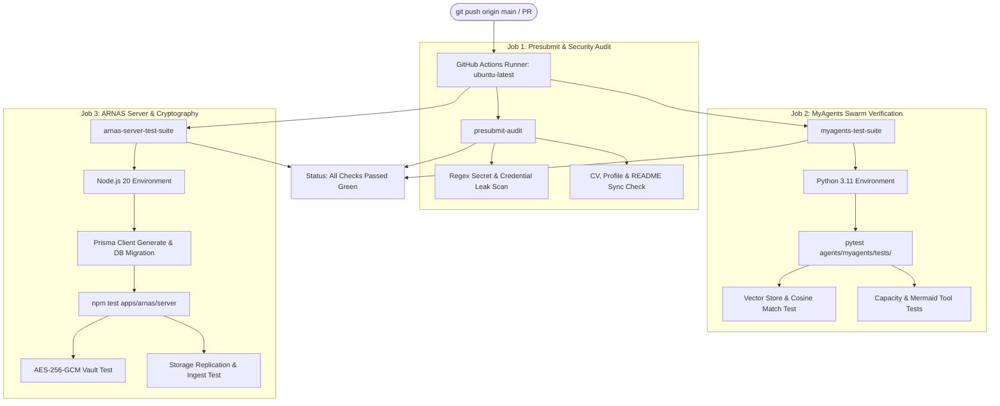

# 🛠️ Monorepo CI Pipeline: Technical Design Document

> **Document Version**: 1.0.0  
> **Status**: Approved & Production Ready  
> **Component**: GitHub Actions Continuous Integration & Presubmit Security  
> **Author**: Abhijeet Raut ([@arauthub](https://github.com/arauthub))  

---

## 1. Executive Summary & Architecture Goals

Monorepos containing disparate technology stacks (Python AI agents, Node/Fastify distributed storage, Manifest V3 extensions, Angular/Django fullstack applications) present unique CI/CD verification challenges. A regression in one service or accidental credential exposure in another must be caught before code reaches production branches.

**DevOps CI & Presubmit Suite** provides an automated, multi-stage validation matrix:
1. **Automated Secret Leak Prevention**: Pre-commit and pre-push regex scanning catching private keys, AWS tokens, GitHub PATs, and Google API keys.
2. **Monorepo Documentation Synchronization**: Automated validation that `CV_Abhijeet_Raut.md`, `PROFILE.md`, and `README.md` catalog every active project accurately.
3. **Multi-Agent Python Test Pipeline**: Automated execution of unit tests for semantic vector search, tool calling registries, and DAG orchestration.
4. **ARNAS Distributed Storage Pipeline**: Automated Vitest testing of Fastify authentication, AES-256-GCM encryption vaults, and storage failover clustering.

---

## 2. Complete Technology Stack & Specifications

| Layer | Component | Version / Specification | Rationale & Trade-offs |
| :--- | :--- | :--- | :--- |
| **CI Platform** | GitHub Actions | Runner: `ubuntu-latest` | Cloud-native, zero infrastructure management, integrated PR status checks. |
| **Security Scanner** | Python Presubmit Engine | Custom `scripts/presubmit.py` | Fast regex-based credential leak scanner with zero external SaaS token requirements. |
| **Python CI Runtime** | Python 3.11 + Pytest | Python 3.11 / Pytest 8+ | Fast test runner executing vector math and agent state transitions in under 3 seconds. |
| **Node CI Runtime** | Node.js 20.x + Vitest | Node.js 20 / Vitest 1.3+ | ESM-native test runner validating Fastify route schemas, Prisma migrations, and crypto operations. |
| **Database Engine (CI)**| SQLite & In-Memory Storage | Zero External Service | Fast, self-contained CI testing requiring no external database service containers. |

---

## 3. CI Pipeline Execution Topology



---

## 4. Key Subsystem Specifications

### 4.1. Presubmit Security Engine (`scripts/presubmit.py`)
* Scans all staged, modified, and unpushed files across:
  * Private Keys (`-----BEGIN RSA/EC/OPENSSH PRIVATE KEY-----`)
  * AWS Access Key IDs & Secret assignments
  * GitHub Personal Access Tokens (`ghp_...`, `github_pat_...`)
  * Google API Keys (`AIza...`)
  * Slack tokens & raw Bearer tokens
  * Unmasked `.env` files (except `.env.example`)
* Aborts git push/commit immediately with actionable line numbers if secrets are detected.

### 4.2. GitHub Actions Workflow (`ci.yml`)
* Trigger conditions: `push` to `main`, `pull_request` to `main`.
* Concurrency groups to cancel outdated in-flight builds on rapid commits.

### 4.3. Version-Controlled Git Hooks Architecture (`.githooks/`)
* **Pre-Commit Hook (`.githooks/pre-commit`)**:
  * Intercepts `git commit` invocations before changes write to the local index.
  * Audits staged files and staged hunks (`git diff --cached`) for sensitive tokens, unmasked `.env` files, and private keys.
  * Strictly exits with status code `1` if violations exist, immediately aborting the commit.
* **Pre-Push Hook (`.githooks/pre-push`)**:
  * Intercepts `git push` invocations before transmission to upstream remotes.
  * Audits unpushed commits (`origin/main...HEAD`) and synchronizes portfolio documentation.
  * Strictly exits with status code `1` if unmasked credentials or secrets exist, immediately halting the push.
* **Activation**:
  * Activated globally or per-repo via `git config core.hooksPath .githooks` (managed via `scripts/setup-hooks.sh`).

### 4.4. Historical Secret Purge & Reference Deletion Engine (`scripts/purge-sensitive-history.sh`)
* **Purpose**: Completely expunges sensitive files or tokens from Git history across all commits, branches, and tags.
* **Mechanism**:
  1. Creates an isolated backup tag (`backup-before-purge-<pid>`).
  2. Uses `git filter-branch` to rewrite commit trees:
     - File purge: removes index entries across all commits (`git rm --cached --ignore-unmatch <pattern>`).
     - Token purge: rewrites file contents across all commit trees, replacing secrets with `[REDACTED_BY_PRECOMMIT]`.
  3. Purges all backup references in `refs/original/`.
  4. Forces reflog expiration: `git reflog expire --expire=now --all`.
  5. Prunes unreachable loose blobs: `git gc --prune=now --aggressive`.
  6. Guarantees 0 remaining historical references.

---

## 5. Execution & Verification Runbook

### Local Presubmit Run
```bash
# Run security and documentation sync check locally
python3 scripts/presubmit.py
```

### GitHub Actions Activation
To activate in GitHub Actions on `arauthub/All-Projects`:
```bash
mkdir -p .github/workflows
cp devops/ci/ci.yml .github/workflows/ci.yml
git add .github/workflows/ci.yml
git commit -m "ci: enable monorepo verification workflow"
git push origin main
```
