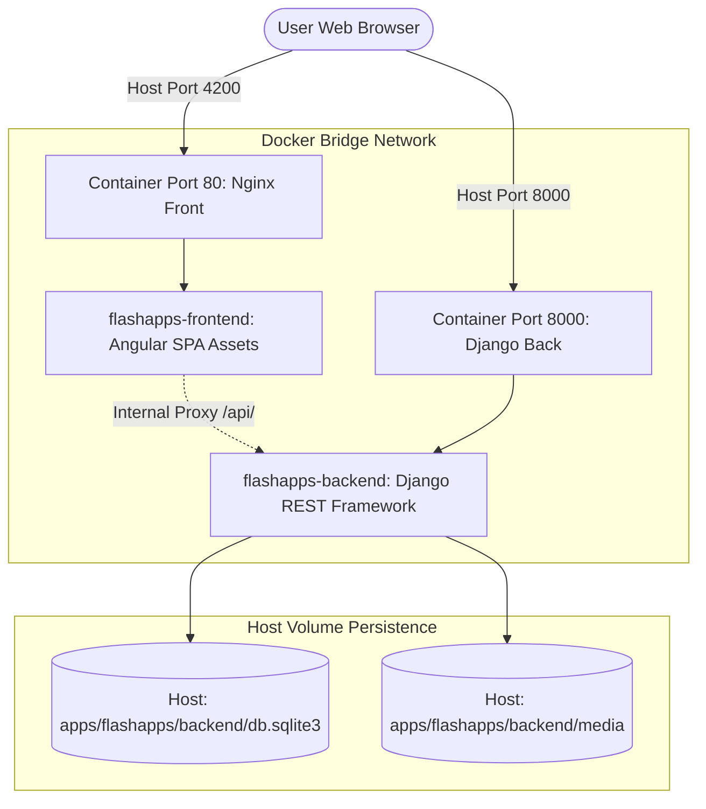

# 🐳 Docker Orchestration: Technical Design Document

> **Document Version**: 1.0.0  
> **Status**: Approved & Production Ready  
> **Component**: Multi-Container Composition & Volume Persistence  
> **Author**: Abhijeet Raut ([@arauthub](https://github.com/arauthub))  

---

## 1. Executive Summary & Architecture Goals

Local multi-tier application development often suffers from divergent runtime versions (Node vs Python incompatibilities), complex port binding conflicts, and fragile state storage across container restarts.

**DevOps Docker Orchestration** provides a unified, production-mirroring multi-container environment:
1. **Zero-Configuration Multi-Service Composition**: Orchestrates decoupled Python/Django REST backends and reactive Angular/Nginx frontend SPAs with a single `docker compose up` command.
2. **Persistent Host Volumes**: Binds local SQLite databases (`db.sqlite3`) and user-uploaded media (`media/`) into containers, ensuring zero data loss across container teardown and rebuilds.
3. **Internal Bridge Networking**: Establishes DNS-resolvable container networking allowing frontend reverse proxies to communicate securely with backend APIs.
4. **Optimized Multi-Stage Builds**: Drastically reduces image sizes through multi-stage build caching.

---

## 2. Complete Technology Stack & Specifications

| Layer | Component | Version / Specification | Rationale & Trade-offs |
| :--- | :--- | :--- | :--- |
| **Container Engine** | Docker Engine & Docker Compose | Engine 24+ / Compose v2.20+ | Universal container orchestration standard with declarative YAML composition. |
| **Backend Service** | Python 3.9 + Gunicorn / WSGI | Alpine / Debian Slim | Lightweight base image running Django REST Framework with fast cold starts. |
| **Frontend Service** | Nginx Alpine | Nginx 1.25-alpine | Ultra-lightweight (<25MB) static HTTP server providing gzip compression and single-page application fallback routing. |
| **Persistence Layer** | Docker Host Volume Binds | POSIX File System | Directly binds host-level SQLite database and media files to maintain development parity. |
| **Networking** | Docker Default Bridge Network | User-defined Bridge | Automatic service-name DNS resolution (`http://backend:8000`). |

---

## 3. Container Topology & Network Flow



---

## 4. Key Subsystem Specifications

### 4.1. Compose Specification (`compose.yaml`)
```yaml
version: '3.8'

services:
  backend:
    build: 
      context: ../../apps/flashapps/backend
    container_name: flashapps-backend
    ports:
      - "8000:8000"
    volumes:
      - ../../apps/flashapps/backend/db.sqlite3:/app/db.sqlite3
      - ../../apps/flashapps/backend/media:/app/media
    restart: unless-stopped
    environment:
      - DJANGO_SETTINGS_MODULE=flashapps_backend.settings.dev

  frontend:
    build:
      context: ../../apps/flashapps/frontend
    container_name: flashapps-frontend
    ports:
      - "4200:80"
    depends_on:
      - backend
    restart: unless-stopped
```

### 4.2. Volume Mounting & State Retention Invariants
* The host paths `../../apps/flashapps/backend/db.sqlite3` and `media/` are mapped directly to `/app/db.sqlite3` and `/app/media`.
* Any database transactions, model migrations, or media uploads executed inside the container immediately sync to the host filesystem.

---

## 5. Security & Isolation

1. **Port Isolation**:
   * Services expose strictly necessary external ports (`8000` and `4200`).
2. **Environment Variable Injection**:
   * Settings modules configured via declarative environment directives rather than hardcoded configurations.

---

## 6. Execution & Verification Runbook

### Prerequisites
* Docker Desktop 4.x+ or Docker Engine 24+ & Docker Compose v2+.

### Operational Commands
```bash
cd devops/docker

# 1. Build and start containers in detached mode
docker compose up --build -d

# 2. View streaming logs from both services
docker compose logs -f

# 3. Verify running service health
docker compose ps

# 4. Graceful teardown (preserves volumes)
docker compose down
```

### Verification Endpoints
* **Frontend Application**: [http://localhost:4200](http://localhost:4200)
* **Backend REST API**: [http://localhost:8000](http://localhost:8000)
* **Django Admin**: [http://localhost:8000/admin/](http://localhost:8000/admin/)
