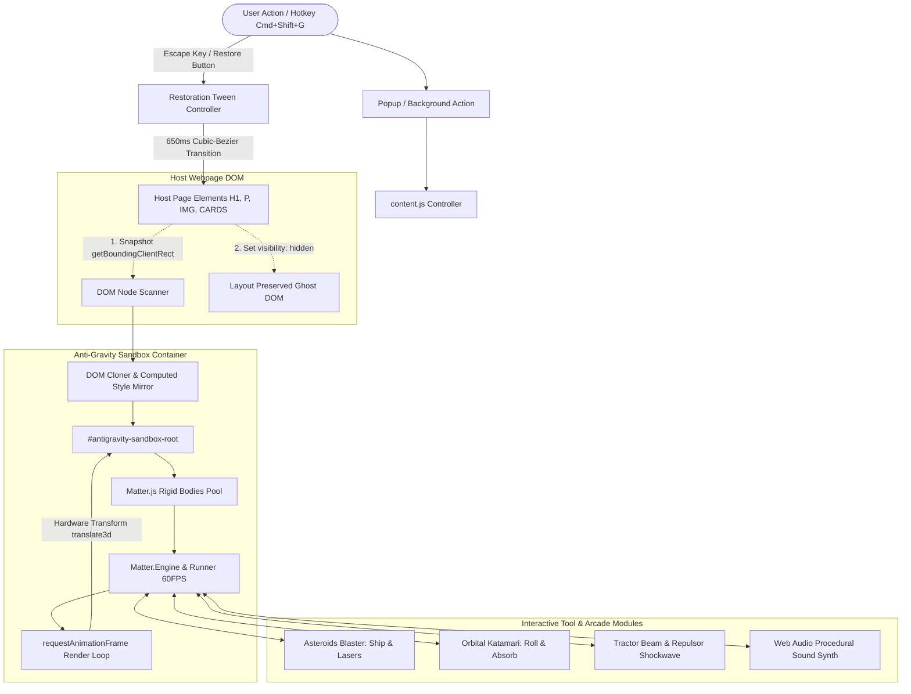

# 🌌 Anti-Gravity Web: Technical Design Document

> **Document Version**: 1.0.0  
> **Status**: Approved & Production Ready  
> **Target Platform**: Google Chrome, Microsoft Edge, Brave (Chromium Manifest V3)  
> **Author**: Abhijeet Raut ([@arauthub](https://github.com/arauthub))  

---

## 1. Executive Summary & Objectives

The web is traditionally a rigid, static two-dimensional document medium. **Anti-Gravity Web** is an advanced browser extension (Manifest V3) that transforms any live web page into an interactive, zero-latency 2D physics playground and gamified arcade sandbox without permanently damaging the host page layout or breaking web applications.

### Core Objectives:
1. **Non-Destructive DOM Virtualization**: Safely clone visible DOM nodes into an isolated canvas-anchored overlay while keeping the host document layout intact.
2. **Deterministic 2D Rigid Body Physics**: Locally bundled Matter.js engine driving 60 FPS collisions, restitution, air drag, and directional gravity inversion.
3. **Interactive Force Fields & Kinetic Manipulation**: Multi-touch and mouse tractor beams, repulsor blast shockwaves, and physics-based flinging.
4. **Arcade Gaming Overlay**: Integrated Asteroids space combat and Katamari rolling absorption mechanics rendered directly on live page elements.
5. **Procedural Web Audio**: Zero-asset, zero-network synthesized 8-bit sound effects using the Web Audio API.
6. **Flawless Restoration**: Single-click or `Escape` key restoration returning all elements smoothly to their exact initial layout coordinates.

---

## 2. Technology Stack & Architecture Justification

| Subsystem | Technology / Library | Version / Spec | Rationale & Trade-offs |
| :--- | :--- | :--- | :--- |
| **Extension Model** | Chromium Extensions API | Manifest V3 (MV3) | Compliance with Chrome Web Store; strict prohibition of remote code execution; secure isolated content scripts. |
| **Physics Simulation** | Matter.js | 0.19.0 (Local Bundle) | High-performance 2D rigid-body physics engine, collision detection (SAT - Separating Axis Theorem), and constraint solver bundled locally in `lib/matter.min.js`. |
| **DOM Rendering Pipeline** | Native HTML5 + CSS 3D Transforms | Hardware-Accelerated | Maps Matter.js rigid body coordinates directly to `transform: translate3d(x, y, 0) rotate(θ)` bypassing DOM reflow and layout thrashing. |
| **Audio Synthesizer** | Web Audio API (`AudioContext`) | Native Web API | Synthesizes retro sound effects (sine/square wave oscillators, noise buffers, exponential gain decays) with zero network downloads or external audio files. |
| **State Storage** | `chrome.storage.local` | Native Chrome API | Persists user preferences (gravity multiplier, selected difficulty stage, audio mute state, tutorial completion) across sessions. |
| **UI Design System** | Glassmorphic Vanilla CSS | Custom Tokens | High-contrast neon cyan/purple aesthetics matching the zero-G theme; scoped inside isolated extension UI namespaces. |
| **Packaging & CI** | POSIX Shell (`package.sh`) | Bash 4+ / Zip | Generates deterministic production build artifact in `dist/anti-gravity-browser-v1.0.0.zip`. |

---

## 3. System Architecture & Lifecycle Topology



---

## 4. Key Subsystem Specifications

### 4.1. DOM Extraction & Style Cloning Pipeline
To prevent the host page layout from collapsing into a broken heap when physics starts:
1. **Selection Filter**: Scans only interactive, semantically meaningful visible elements (`h1-h6`, `p`, `blockquote`, `img`, `button`, `.card`, `article > *`).
2. **Coordinate Snapshot**: Captures `getBoundingClientRect()` relative to viewport scroll offset.
3. **Ghosting**: Sets original elements to `visibility: hidden; pointer-events: none;`, retaining exact layout margins, padding, flexbox, and grid spacing in the underlying document.
4. **Sandbox Virtualization**: Clones elements into `#antigravity-sandbox-root` with:
   - `position: absolute;`
   - Explicit `width` and `height` derived from computed geometry.
   - Exact computed fonts, background colors, borders, and box-shadows.

### 4.2. Matter.js Physics Engine Synchronization
* **World Bounds**: Four static perimeter rectangular bodies (`top`, `bottom`, `left`, `right`) aligned with `window.innerWidth` and `window.innerHeight`.
* **Rigid Body Creation**: Each cloned DOM node receives a corresponding `Matter.Bodies.rectangle(cx, cy, width, height, options)` with:
  - `restitution: 0.65` (bouncy elastic collisions).
  - `frictionAir: 0.015` (gentle cosmic drag).
  - `density: 0.001 * (width * height)`.
* **60 FPS Render Loop**:
  ```javascript
  function onPhysicsTick() {
    for (let i = 0; i < trackedNodes.length; i++) {
      const node = trackedNodes[i];
      const body = node.matterBody;
      const x = body.position.x - node.halfWidth;
      const y = body.position.y - node.halfHeight;
      const deg = body.angle * (180 / Math.PI);
      node.element.style.transform = `translate3d(${x}px, ${y}px, 0px) rotate(${deg}deg)`;
    }
    requestAnimationFrame(onPhysicsTick);
  }
  ```

### 4.3. Arcade Game Modes
1. **Asteroids Blaster**:
   - Spawns a triangular vector interceptor at cursor position.
   - Thrust vectors applied via `WASD` or cursor orientation.
   - Dual laser projectiles fire along ship heading at 25 px/frame.
   - Collision detection against DOM rigid bodies triggers damage flash, structural fracture (splitting into word fragments), particle bursts, and score increments.
2. **Orbital Katamari**:
   - Spawns a rolling spherical attractor body controlled via directional inputs.
   - Computes rolling angular velocity based on linear momentum.
   - Radius grows proportionally as smaller objects contact and weld to the sphere via `Matter.Constraint.create()`.

### 4.4. Procedural Web Audio Engine
* Uses `AudioContext` with zero external audio assets.
* **Laser Blast**: 880 Hz down-swept frequency to 110 Hz over 90 ms using `exponentialRampToValueAtTime`.
* **Explosion / Impact**: White noise buffer passed through a 400 Hz low-pass biquad filter with rapid exponential decay.
* **Restoration Chord**: Polyphonic major arpeggio (`C5`, `E5`, `G5`, `C6`) played concurrently over 650 ms upon graceful layout restoration.

---

## 5. Security & Manifest V3 Sandboxing

1. **Manifest V3 Local Packaging**:
   * Contains **zero external script references** (Matter.js is bundled locally in `lib/matter.min.js`).
   * No `eval()` or `new Function()` execution.
2. **Content Script Isolation**:
   * Operates strictly in the extension's isolated content script world.
   * Does not modify window-global variables of host websites, protecting sensitive single-page application state (e.g., Redux stores, React roots).
3. **Safe Storage**:
   * Local storage stores strictly game settings and high scores; zero browsing telemetry or visited URLs are recorded.

---

## 6. Execution & Verification Runbook

### Prerequisites
* Google Chrome (v109+), Microsoft Edge (v109+), or Brave browser.

### Installation
1. Open `chrome://extensions/`.
2. Enable **Developer mode**.
3. Click **Load unpacked** and select `/Users/abhijeetraut/Documents/All-Projects/extensions/anti-gravity-browser`.

### Functional Verification
1. Open the included test suite page:
   ```text
   file:///Users/abhijeetraut/Documents/All-Projects/extensions/anti-gravity-browser/test-page/index.html
   ```
   Or visit any rich web page (e.g., Wikipedia, GitHub).
2. Activate extension:
   * Press `Alt+Shift+G` (or `Cmd+Shift+G` on Mac) or click the toolbar icon.
   * Verify semantic headings, text paragraphs, and cards detach into zero-G floating bodies.
3. Test physics interactions:
   * Press `Arrow Up` / `Arrow Down` / `Arrow Left` / `Arrow Right`: Verify gravity inverts immediately.
   * Press `0` or `Z`: Verify microgravity zero-drift mode.
   * Left-click and drag: Verify kinetic flinging.
4. Test arcade modes:
   * Select **Asteroids Blaster** in HUD: Fly with `WASD`, shoot with `Spacebar`.
   * Select **Orbital Katamari**: Roll across page and absorb elements.
5. Test restoration:
   * Press `Escape`: Verify all elements glide smoothly back to original CSS positions within 650ms.

### Packaging
```bash
cd extensions/anti-gravity-browser
bash scripts/package_extension.sh
```
Verify `dist/anti-gravity-browser-v1.0.0.zip` is created.
