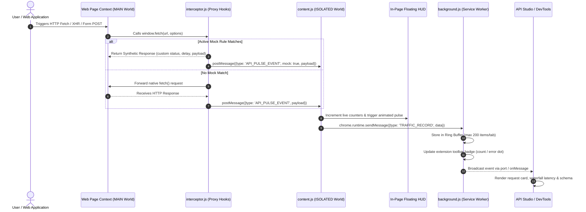

# ⚡ API Pulse Pro: Technical Design Document

> **Document Version**: 1.0.0  
> **Status**: Approved & Production Ready  
> **Target Platform**: Google Chrome, Microsoft Edge, Brave (Chromium Manifest V3)  
> **Author**: Abhijeet Raut ([@arauthub](https://github.com/arauthub))  

---

## 1. Executive Summary & Objectives

Modern single-page applications (React, Angular, Vue, Next.js) execute dozens of asynchronous network requests per user interaction. Standard browser DevTools Network panels aggregate all traffic indiscriminately—mixing CSS stylesheets, font files, telemetry pings, and image chunks with critical business REST and GraphQL calls. Inspecting complex POST payloads, replaying requests in the authenticated browser session, and simulating edge-case server errors require cumbersome external tools like Postman or Charles Proxy.

**API Pulse Pro** is an IDE-grade Chrome Manifest V3 browser extension and DevTools suite that provides:
1. **Real-time API & POST monitoring**: Zero-configuration capture of `fetch()` and `XMLHttpRequest` traffic.
2. **In-Page Heads-Up Display (HUD)**: Non-intrusive floating status indicator and expandable drawer right inside the application viewport.
3. **Dedicated Full-Page API Studio Workbench**: IDE-grade interface for deep request/response inspection, payload filtering, and timing waterfall analysis.
4. **In-Browser Mocking & Stubbing Engine**: Dynamic interception and synthesis of server responses (wildcards, regex, latency delays, custom HTTP status codes).
5. **In-Page Session-Aware Replay**: Re-executing captured HTTP requests directly inside the page context, inheriting active cookies, CSRF tokens, and credentials.
6. **Developer Utility Suite**: Auto-generated TypeScript interfaces, multi-language code snippets (cURL, Axios, Python `requests`, Go), side-by-side JSON diffing, and live JWT token decoding.

---

## 2. Technology Stack & Prerequisites

| Layer / Subsystem | Technology | Version / Specification | Rationale & Justification |
| :--- | :--- | :--- | :--- |
| **Extension Framework** | Chrome Extensions API | Manifest V3 (MV3) | Compliance with Chrome Web Store standards; declarative service workers; enhanced security sandbox. |
| **Language Runtime** | JavaScript (ES6+ / ECMAScript 2022) | Native Browser Runtime | Maximum execution speed, zero compile-step overhead for extension loading, native `async/await` and ES modules. |
| **Network Interception** | DOM Monkey-Patching (`fetch` & `XHR`) | Native Web APIs | Complete parity with native browser network primitives; zero external SDK dependencies. |
| **Inter-Context IPC** | `window.postMessage` + `chrome.runtime.onMessage` | Native Browser IPC | Secure communication bridging MAIN world (page context) to ISOLATED world (content script) to background service worker. |
| **UI & Styling** | Vanilla CSS3 (Custom Properties & Glassmorphism) | Modern CSS (Grid/Flexbox) | High-performance 60 FPS rendering; zero runtime style library overhead; scoped CSS containment preventing host site style pollution. |
| **Type Generation Engine** | Custom AST & Schema Inference Engine | Native JavaScript | Parses JSON request/response payloads to derive strongly typed TypeScript interfaces with nested object and array handling. |
| **Token Decoder** | Base64URL + JSON Stream Parser | Native Web API | High-speed, zero-dependency decoding of JWT headers and claims with real-time expiration countdown. |
| **Packaging & Build** | POSIX Shell (`bash`) + `zip` | Bash 4+ / Info-ZIP | Clean, reproducible production packaging into standard ZIP format for Chrome Web Store and Edge Add-ons. |
| **Host Environment** | Chromium Engine | Chrome 109+, Edge 109+, Brave | Supports Offscreen documents, service worker MV3 lifecycle, and Declarative Net Request. |

---

## 3. System Architecture & Context Flow

The extension operates across three distinct execution contexts with strict boundary separation:
1. **MAIN Execution World (`content/interceptor.js`)**: Runs in the webpage's JavaScript context to hook `window.fetch` and `window.XMLHttpRequest`.
2. **ISOLATED Execution World (`content/content.js`)**: Manages the In-Page HUD and drawer DOM elements inside the tab without contaminating the page's global variables.
3. **Background Service Worker (`background/background.js`)**: Manages tab state, badge indicators, hotkeys, and routes messages between tabs, DevTools, and the Studio workbench.
4. **Client Workbenches (`popup/`, `devtools/`, `studio/`)**: Standalone user interfaces querying the service worker for captured events.



---

## 4. Key Subsystem Specifications

### 4.1. Network Interception Pipeline (`interceptor.js`)
* **Execution Environment**: Injected into the document root via `manifest.json` under `"world": "MAIN"`, `"run_at": "document_start"`.
* **Fetch Wrapping**:
  ```javascript
  const originalFetch = window.fetch;
  window.fetch = async function(...args) {
    const startTime = performance.now();
    // Intercept, clone request, record headers & body
    // Check against window.__API_PULSE_MOCKS__
    const response = await originalFetch.apply(this, args);
    const cloned = response.clone();
    // Record status, duration, response body
    // Dispatch window.postMessage with unique ID
    return response;
  };
  ```
* **XHR Wrapping**: Prototypes of `XMLHttpRequest.prototype.open`, `setRequestHeader`, and `send` are wrapped with state listeners capturing `readystatechange` and `loadend`.
* **Content-Type Serialization**: Safely deserializes `application/json`, `application/x-www-form-urlencoded`, `multipart/form-data`, and `text/plain`.

### 4.2. In-Browser Mocking Engine
* **Rule Definitions**:
  * `pattern`: Wildcard string (e.g., `*/api/v1/auth/login`) or regular expression.
  * `method`: `ALL`, `GET`, `POST`, `PUT`, `DELETE`, `PATCH`.
  * `statusCode`: Configurable HTTP status (200, 201, 400, 401, 403, 404, 500, 503).
  * `delayMs`: Artificial latency slider (0 ms to 3000 ms) via `new Promise(r => setTimeout(r, delayMs))`.
  * `responseBody`: Custom JSON string or raw text payload.
* **Non-Destructive Bypass**: If mocking is globally toggled OFF or rule is deactivated, native network calls pass through with zero latency penalty (<0.2ms overhead).

### 4.3. Full-Screen Studio Workbench (`studio/studio.html`)
* **Layout**: Dual-pane IDE workbench with draggable splitters.
* **Left Pane (Live Stream)**: Virtualized feed of captured transactions with status pill badges, method tags, latency timers, and URL filters.
* **Right Pane (Deep Inspection)**:
  * **Headers**: Raw & formatted request/response HTTP headers.
  * **Payload**: Formatted JSON viewer with copy, tree expansion, and raw view.
  * **Response**: Syntax-highlighted response viewer with formatting and download.
  * **Replay**: In-page re-execution button with customizable headers and body editor.
  * **TypeScript Generator**: Derives interfaces via schema analyzer.
  * **Code Snippets**: Exports cURL, Axios, fetch, Python, and Go snippets.
  * **Security**: Decodes JWT tokens (Header, Payload, Expiry countdown).
  * **JSON Diff**: Side-by-side comparative diff of two captured responses.

---

## 5. Security, Privacy & Permission Architecture

1. **Manifest V3 Least Privilege**:
   * `"permissions": ["activeTab", "storage", "scripting"]`
   * `"host_permissions": ["<all_urls>"]`: Required solely to enable page-context network hooks on arbitrary developer target hosts.
2. **Zero Remote Communication (100% Client-Side)**:
   * The extension makes **zero** outbound telemetry requests, includes **zero** tracking scripts, and contains **no third-party CDNs**.
   * All network interception, mocking, schema generation, and JWT decoding execute entirely inside the user's browser runtime.
3. **Data Sanitization**:
   * Internal ring buffers are maintained per tab and automatically flushed when the tab closes or the session ends.
   * Sensible memory limits: Maximum 200 captured entries per tab to maintain minimal memory footprint (<15 MB RAM).

---

## 6. Execution & Verification Runbook

### Prerequisites
* Google Chrome (v109+), Microsoft Edge (v109+), or Chromium browser.
* Node.js v18+ (only if regenerating icon assets via `scripts/generate_assets.js`).

### Installation
1. Navigate to `chrome://extensions/`.
2. Toggle **Developer mode** to **ON**.
3. Click **Load unpacked** and choose `/Users/abhijeetraut/Documents/All-Projects/extensions/api-pulse-pro`.

### Functional Verification
1. Open the included API Playground:
   ```text
   file:///Users/abhijeetraut/Documents/All-Projects/extensions/api-pulse-pro/test-page/index.html
   ```
2. Trigger the test endpoints:
   * Click **POST User Login**: Verify JWT is captured, status `200`, token decoded in Security tab.
   * Click **POST Checkout**: Verify nested JSON payload, generate TypeScript interface.
   * Click **500 Server Error**: Verify instant red error badge in HUD and Studio stream.
   * Click **Simulate Slow API**: Verify timing waterfall displays >1200ms latency.
3. Press `Alt+Shift+P`: Verify in-page HUD drawer expands smoothly without conflicting with native Ctrl+A / Cmd+A selection.
4. Press `Alt+Shift+S`: Verify API Studio workbench opens in a dedicated tab.

### Packaging
```bash
cd extensions/api-pulse-pro
./package.sh
```
Verify `dist/api-pulse-pro-v1.0.0.zip` is generated cleanly.
