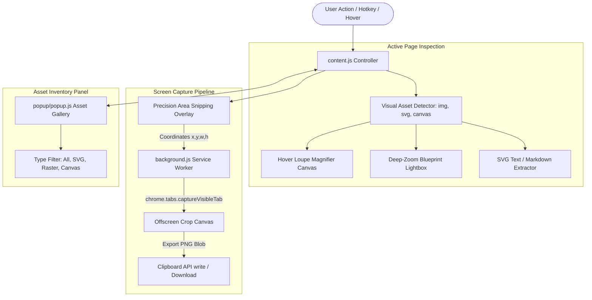

# 🔍 Diagram & Image Lens Pro: Technical Design Document

> **Document Version**: 1.0.0  
> **Status**: Approved & Production Ready  
> **Target Platform**: Google Chrome, Microsoft Edge, Brave (Chromium Manifest V3)  
> **Author**: Abhijeet Raut ([@arauthub](https://github.com/arauthub))  

---

## 1. Executive Summary & Objectives

Modern engineering documentation, cloud architecture diagrams, scientific publications, and patent filings rely heavily on dense visual graphics (high-resolution PNGs, intricate SVGs, Mermaid/PlantUML diagrams, circuit schematics). Engineers often struggle to read fine-print labels, analyze complex schematics, or extract embedded text without clumsy downloads or third-party graphic editors.

**Diagram & Image Lens Pro** provides an IDE-grade visual inspection and asset extraction environment inside Chromium browsers:
1. **Interactive Hover Loupe (2x–16x)**: Zero-latency real-time magnifying loupe tracking ``, `<svg>`, and `<canvas>` elements.
2. **Deep-Zoom Blueprint Lightbox**: Infinite-pan full-screen inspection canvas (10% to 1000% zoom) with schematic inversion and contrast enhancement.
3. **Area Snipping & High-DPI Capture**: Precision crosshair rectangle snipping taking pixel-perfect captures scaled to the device pixel ratio.
4. **Vector Label & SVG Extraction**: Direct extraction of text nodes (`<text>`, `<tspan>`) from complex vector diagrams.
5. **One-Click Export Pipeline**: Clipboard PNG write (`ClipboardItem`), Markdown formatting (``), and raw vector downloads.
6. **Page Visual Asset Scanner**: Dynamic inventory of all page visual assets with search and filtering.

---

## 2. Technology Stack & Prerequisites

| Subsystem | Technology | Specification / Version | Rationale & Trade-offs |
| :--- | :--- | :--- | :--- |
| **Extension Platform** | Chromium Extensions API | Manifest V3 (MV3) | Compliance with Chrome Web Store & Edge Add-on stores; service worker lifecycle; isolated content scripts. |
| **Viewport Magnification** | HTML5 Canvas 2D API | Hardware-Accelerated | Direct blitting of image source pixels into a circular/square offscreen canvas with bilinear interpolation and crosshair reticle. |
| **Screen Snipping** | `chrome.tabs.captureVisibleTab` | Chromium API | High-resolution lossless viewport capture cropped via in-memory canvas scaled to `window.devicePixelRatio`. |
| **Clipboard Integration** | Asynchronous Clipboard API (`ClipboardItem`) | W3C Standard | Direct clipboard write of `image/png` blobs without user-facing temporary file downloads. |
| **Vector Processing** | DOMParser & XMLSerializer | Native Web APIs | Parses SVG DOM trees to extract embedded labels, sanitize viewBox bounds, and export standalone scalable vector blobs. |
| **UI Design System** | Scoped Dark Glassmorphic CSS | Modern CSS3 | Neon amber/cyan accent scheme, backdrop-filter blur, CSS isolation preventing host CSS bleed. |
| **Packaging & CI** | POSIX Shell (`package.sh`) | Bash 4+ / Zip | Deterministic ZIP packaging in `dist/diagram-image-lens-v1.0.0.zip`. |

---

## 3. System Architecture & Component Flow



---

## 4. Key Subsystem Specifications

### 4.1. Hover Loupe Magnifier (`content/content.js`)
* **Trigger Mechanism**: Activates on hover when global loupe is toggled ON (`Cmd+Shift+M`) or when hovering over visual elements (`img`, `svg`, `canvas`, `[role="img"]`).
* **Coordinate Mapping**:
  * Calculates cursor relative offset within the target bounding box: `relX = clientX - rect.left`, `relY = clientY - rect.top`.
  * Computes source rectangle on original image: `srcX = (relX / rect.width) * naturalWidth`.
* **Lens Shapes**:
  * `circle`: Circular aperture with radial gradient border and neon crosshair reticle.
  * `square`: Rounded rectangular aperture with corner registration marks.
* **Dynamic Zoom**: Keyboard shortcuts `+` and `-` dynamically adjust magnification multiplier (2x, 3x, 4x, 8x, 16x) with instant canvas redraw.

### 4.2. Deep-Zoom Blueprint Lightbox
* **Canvas Controller**: Full-screen modal housing a zoomable `<canvas>` or transformed image element.
* **Transform Engine**:
  * Matrix transform: `translate(${panX}px, ${panY}px) scale(${zoomLevel}) rotate(${rotationDeg}deg)`.
  * Zoom range: `0.1x` (10%) to `10.0x` (1000%) with smooth mouse wheel dampening.
* **Schematic Invert Mode**:
  * Applies CSS filter: `invert(1) hue-rotate(180deg) contrast(1.2)` turning dark background schematics into crisp, high-contrast engineering prints.
* **SVG Text Extraction**:
  * Iterates over `<text>` and `<tspan>` nodes within SVG diagrams.
  * Compiles ordered list of textual labels, architectural annotations, and variable names; copies to clipboard as formatted text.

### 4.3. Area Snipping & DPI Scaling
1. User presses `Cmd+Shift+S` (Mac) or `Alt+Shift+S` (Win).
2. Snipping overlay renders full-screen crosshair guide with semi-transparent dark backdrop.
3. User drags rectangle bounding box `[x, y, width, height]`.
4. Service worker captures visible tab viewport using `chrome.tabs.captureVisibleTab(null, {format: 'png'})`.
5. Offscreen canvas crops sub-rectangle accounting for device pixel ratio (`DPR = window.devicePixelRatio`):
   $$\text{cropX} = x \times DPR, \quad \text{cropY} = y \times DPR$$
6. Instantly copies PNG blob to system clipboard via `navigator.clipboard.write([new ClipboardItem({'image/png': blob})])`.

---

## 5. Security & Manifest V3 Sandboxing

1. **Manifest V3 Least Privilege**:
   * Uses `activeTab`, `storage`, and `scripting` permissions.
   * Zero remote scripts; strictly bundled locally.
2. **Zero Exfiltration Guarantee**:
   * All images, screenshots, diagrams, and extracted text are processed exclusively in local memory.
   * Zero telemetric reporting, tracking beacons, or third-party analytics.
3. **CORS Handling for Canvas Exports**:
   * For cross-origin raster images, if tainted canvas restrictions prevent `toBlob()`, the extension gracefully falls back to direct URL fetching or tabs capture.

---

## 6. Execution & Verification Runbook

### Prerequisites
* Google Chrome (v109+) or Microsoft Edge (v109+).

### Installation
1. Navigate to `chrome://extensions/` or `edge://extensions/`.
2. Enable **Developer mode**.
3. Click **Load unpacked** and select `/Users/abhijeetraut/Documents/All-Projects/extensions/diagram-image-lens`.

### Functional Verification
1. Open the included test harness:
   ```text
   file:///Users/abhijeetraut/Documents/All-Projects/extensions/diagram-image-lens/test_demo.html
   ```
2. Test Hover Loupe:
   * Hover over the architecture diagram and press `+` / `-` to verify zoom scaling.
   * Press `Cmd+Shift+M` to toggle loupe overlay.
3. Test Deep-Zoom Lightbox:
   * Hover over any diagram and press `Z`. Verify full-screen lightbox opens.
   * Drag to pan; scroll mouse wheel to zoom (10% to 1000%).
   * Press `I` to toggle schematic blueprint inversion.
   * Press `T` to extract all SVG text labels.
   * Press `Esc` to close lightbox.
4. Test Snipping Tool:
   * Press `Cmd+Shift+S` (or `Alt+Shift+S`). Drag a bounding box over any area.
   * Verify snip action bar allows 1-click clipboard copy and PNG download.

### Packaging
```bash
cd extensions/diagram-image-lens
./package.sh
```
Verify `dist/diagram-image-lens-v1.0.0.zip` is generated cleanly.
